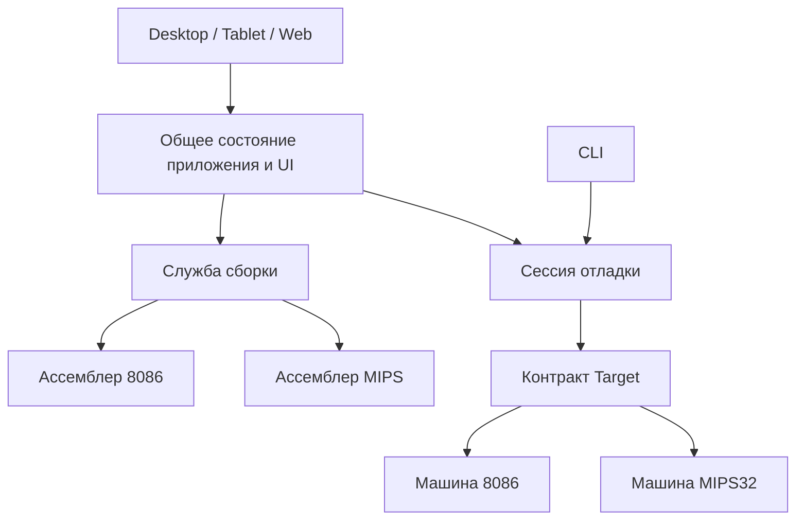
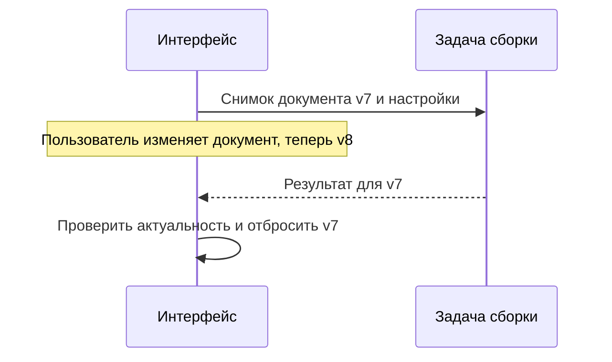

# RustEmu8086: архитектура и принятые решения

Состояние на 9 ноября 2026 года, коммит `7e4f26a`.

Документ объясняет устройство проекта и цену основных решений. Он предназначен для человека,
который хочет разобраться в системе до чтения исходников: разработчика, автора учебного курса
или участника технического обсуждения. Здесь описана текущая реализация. Будущие изменения
вынесены в отдельный раздел.

## 1. Что мы строим

RustEmu8086 — учебная среда для программ на ассемблере. Пользователь открывает исходник,
собирает программу, запускает её, наблюдает регистры, память и устройства, а затем может
вернуться на несколько инструкций назад.

Сейчас среда поддерживает две архитектуры:

- **8086** с сопроцессором и окружением в духе Emu8086. Для совместимости учебных примеров
  по умолчанию доступны и расширения 80186.
- **MIPS32** с ассемблером, системными сервисами и устройствами, ориентированными на MARS.

Один и тот же проект работает как приложение macOS, браузерная версия и CLI. В браузере
есть две компоновки: привычная оконная и планшетная.

Главный критерий архитектуры — законченный учебный сценарий. Правильно выполнить `ADD`
недостаточно: исходник должен собраться, системный сервис — выдать ожидаемый результат,
а отладчик — показать, какая строка к нему привела. При этом система должна сохранять
управляемость, когда пользователь открывает ошибочную или слишком дорогую программу.

## 2. Общая картина

В проекте есть четыре крупных области: машины, ассемблеры, сессия отладки и интерфейс.
Сборку обслуживает отдельный компонент фоновых задач.

Это схема ответственности и основных обращений, а не полный граф зависимостей Cargo.
Например, сессия знает конкретные загрузчики обеих архитектур, а специальные окна UI
обращаются к конкретной машине.

### Из каких крейтов состоит проект

| Крейт | За что отвечает |
|---|---|
| [`rustemu-target`](crates/rustemu-target/src/lib.rs) | Общий контракт машины, события, непрозрачные снимки, политика ресурсов и отчёты. Не имеет внешних зависимостей |
| [`rustemu-core`](crates/rustemu-core/src/lib.rs) | 8086, память, 8087, BIOS/DOS, видео, устройства, загрузчики и история |
| [`rustemu-mips`](crates/rustemu-mips/src/lib.rs) | MIPS32, CP0/CP1, память, исключения, сервисы и устройства MARS, собственный ассемблер |
| [`rustemu-asm`](crates/rustemu-asm/src/lib.rs) | Препроцессор и ассемблер 8086 с диалектами Emu8086/MASM и NASM, листинг и информация об исходниках |
| [`rustemu-build`](crates/rustemu-build/src/lib.rs) | Запросы и результаты сборки, загрузка исходников, общий исполнитель и браузерный worker |
| [`rustemu-session`](crates/rustemu-session/src/lib.rs) | Связь машинного состояния с исходником: символы, выражения, точки останова по строкам, Step Over / Out |
| [`rustemu-ui`](crates/rustemu-ui/src/lib.rs) | Документ, редактор, управление сборкой и исполнением, инструменты отладки и общие окна |
| [`rustemu-desktop`](crates/rustemu-desktop/src/lib.rs) | Компоновка в стиле Emu8086 и нативная точка входа |
| [`rustemu-tablet`](crates/rustemu-tablet/src/lib.rs) | Планшетная компоновка и экранная клавиатура |
| [`rustemu-web`](crates/rustemu-web/src/main.rs) | Браузерный запуск, выбор компоновки, взаимодействие со страницей и хранилищем |
| [`rustemu-cli`](crates/rustemu-cli/src/main.rs) | Сборка и выполнение из командной строки |

Такое разделение позволяет проверять инструкции и программы без графического интерфейса.
Изменение компоновки окна не требует изменения семантики CPU.

## 3. Где находится состояние

В коде встречаются похожие слова: машина, программа, сессия и рабочее место. Они обозначают
разные вещи.

| Понятие | Что содержит | Когда меняется |
|---|---|---|
| Документ | Текст редактора, имя/путь, признаки сохранения и идентичность документа | При редактировании и открытии файлов |
| Запрос сборки | Снимок исходника, версию документа, архитектуру, настройки и доступные исходные файлы/пути | Создаётся для одной задачи сборки |
| Собранная программа | Загружаемые байты, символы, листинг и соответствие машинного кода исходнику; у MIPS также настройки образа | При успешной сборке |
| Машина | CPU, память, устройства, ввод/вывод, файловый слой и историю | При загрузке, выполнении и откате |
| Сессия | Машину и информацию, необходимую для отладки программы по исходнику | При загрузке, перезагрузке и работе отладчика |
| Рабочее место | Документ, сессию, окна и состояние инструментов одной архитектуры | При работе с 8086 или MIPS и переключении между ними |

Документ и загруженная машина могут временно относиться к разным версиям программы:
пользователь уже изменил текст, но ещё не пересобрал его. Интерфейс сохраняет эту разницу
явно и не должен запускать прежний образ как результат нового документа.

Настройки приложения и программы браузера хранятся отдельно от живого состояния CPU.
Сохранить исходник и точки останова не означает сохранить всю оперативную память машины
для продолжения после закрытия страницы.

## 4. Путь программы: от редактора до шага назад

### 4.1. Сборка

При нажатии Compile, Emulate или команды, которой сначала нужна сборка, приложение
фиксирует исходные данные запроса. Дальнейшие правки редактора не меняют уже отправленный текст.

На desktop сборку выполняет отдельный поток, в браузере — отдельный WASM Worker.
Оба используют типы `Request`, `Outcome` и `Response` из `rustemu-build`. Результат содержит
собранную программу или диагностику, версию запроса и снимки использованных исходников.

На приёме UI проверяет версию документа, его имя, текст, архитектуру и настройки.
Устаревший результат отбрасывается. Открытие другого документа с тем же текстом также
требует актуальной загрузки машины.

Отмена не требует ждать завершения сборки: нативный исполнитель получает атомарный флаг,
браузер завершает worker. Поздний ответ отменённой задачи не применяется.

### 4.2. Проверка и загрузка — разные действия

**Compile** проверяет/собирает исходник. Для 8086 также позволяет сохранить или скачать
исполняемый файл. У MIPS в проекте нет отдельного выходного executable-формата такого рода.

**Emulate** передаёт собранную программу сессии и загружает её в машину. Для 8086 доступны
COM, EXE, BIN и загрузочные сценарии; для MIPS образ состоит из участков памяти с адресами
загрузки и настройками исполнения.

При ошибке или отмене сборки прежняя машина может остаться доступной для осмотра.
Она не должна незаметно стать «новой программой» при следующем Run. Версия загруженного
документа и признак неуспешной сборки участвуют в проверке готовности к выполнению.

### 4.3. Исполнение

Сессия обращается к машине через `Target`. Машина выполняет инструкции и возвращает
события: продолжение, точку останова, ожидание ввода, ожидание времени, завершение или ошибку.

Ожидание ввода моделируется состоянием машины. Интерфейс получает управление, показывает
поле ввода или диалог и передаёт ответ машине. Опрос без нового ввода не должен создавать
ложные записи истории.

В графическом приложении исполнение пока идёт в потоке UI небольшими порциями. Цель цикла —
около 12 мс работы на кадр. Это кооперативный бюджет: он проверяется между операциями
и не прерывает отдельную долгую инструкцию или обращение к файловой системе хоста.

### 4.4. Объяснение и откат

Сессия сопоставляет адрес со строкой исходника, в том числе с раскрытием макроса.
Инструменты показывают изменения регистров и памяти. Шаг назад восстанавливает состояние
до машинной инструкции, если доступная история и её границы это позволяют.

Строка исходника может породить несколько инструкций. Поэтому шаг по строке, шаг одной
инструкции и Step Over — разные операции, хотя пользователь видит их рядом.

## 5. Ключевые решения и их компромиссы

### Решение 1. Общий контракт Target, специализированные машины

Общие действия описаны трейтом `Target`: исполнение, память, регистры, точки останова,
дизассемблирование и история. Сессия хранит `Box<dyn Target>`, поэтому архитектуру можно
выбрать во время работы приложения.

**Причина.** Действия «шагнуть», «остановиться» и «показать адрес» нужны обеим архитектурам.
Устройство сегментов 8086 или регистров CP0 к общему контракту целиком не относится.

**Цена.** В проекте остаются ветки по архитектуре и downcast для специальных окон.
Добавление третьего CPU потребует загрузчика, адаптера, отладочной интеграции и своих
представлений. Одного `impl Target` недостаточно. Динамические вызовы также входят в цену
горячего пути и подлежат измерению.

См. [контракт машины](crates/rustemu-target/src/lib.rs) и [сессию](crates/rustemu-session/src/lib.rs).

### Решение 2. Свои ассемблеры и карта происхождения кода

8086-ассемблер содержит препроцессор, диалекты, многопроходную сборку и кодирование.
MIPS-ассемблер следует правилам и таблицам MARS, включая макросы и `.include`.
Результат сохраняет происхождение инструкций и данных.

**Причина.** Учебной среде нужны сообщения по исходным строкам, просмотр раскрытия макроса
и отладка по исходнику. Кроме того, сборка должна работать в браузере без запуска внешнего
NASM-процесса.

**Цена.** Язык ассемблера приходится поддерживать как самостоятельную подсистему: выражения,
размеры операндов, метки, директивы, включения и сходимость адресов. NASM используется
как внешний эталон соответствующего диалекта, но не является встроенным backend приложения.
FASM не поддерживается.

См. [ассемблер 8086](crates/rustemu-asm/src/lib.rs) и [ассемблер MIPS](crates/rustemu-mips/src/asm/mod.rs).

### Решение 3. BIOS/DOS через HLE с таблицей векторов прерываний

Программы 8086 используют обычную таблицу векторов. Векторы ведут в ROM-заглушки со служебной
инструкцией и `IRET`; служебная инструкция вызывает обработчик BIOS/DOS на Rust.
Такой подход называется высокоуровневой эмуляцией, HLE.

**Причина.** Можно реализовать нужное учебное окружение без загрузки полноценной DOS,
сохранив для программы механизм вызова и перехвата прерываний.

**Цена.** Поддерживается реализованный набор сервисов. Совпадение поведения CPU не означает
совместимость с любой DOS-системой или тактовую точность компьютера целиком.

См. [машину](crates/rustemu-core/src/machine.rs), [BIOS](crates/rustemu-core/src/bios.rs)
и [DOS](crates/rustemu-core/src/dos.rs).

### Решение 4. Память соответствует устройству архитектуры

У 8086 — фиксированная память 1 МиБ. Видеопамять находится в том же адресном пространстве:
интерфейс рисует её содержимое, а изменения в ней участвуют в обычном откате памяти.

У MIPS — разреженная память со страницами по 4 КиБ и двухуровневым поиском страницы.
Настройки определяют размещение и границы областей, а MMIO-адреса связывают память с устройствами.

**Причина.** Для 8086 небольшой сплошной массив естественен и прост. У MIPS большие значения
адресов не требуют выделять всё 32-битное пространство. При этом поиск страницы находится
в горячем пути и должен оставаться дешёвым.

**Цена.** У машин разные проверки адресов и особые случаи. Например, text-сегмент MARS
при самомодификации имеет наблюдаемые особенности, которые не сводятся к обычной байтовой памяти.
Общая адресная операция `Target` не отменяет этих различий.

См. [память 8086](crates/rustemu-core/src/bus.rs) и [память MIPS](crates/rustemu-mips/src/memory.rs).

### Решение 5. История хранит снимок регистров и изменения

На инструкцию сохраняются регистры и журнал прежних значений перезаписанных байтов.
При откате журнал проигрывается в обратном порядке. Дополнительные снимки системного
состояния нужны для инструкций, способных затронуть устройства, ввод или DOS.
В MIPS изменения генераторов и потребление ввода также журналируются выборочно.

**Причина.** Полная копия памяти на каждую инструкцию слишком дорога. При последовательных
записях в один адрес нужно всё же восстановить значение, существовавшее до инструкции.
Дельта сохраняет необходимое изменение без повторного копирования всей подсистемы.

**Цена.** Каждая новая изменяемая подсистема должна определить собственный откат и учёт
расхода истории. Работа с внешними файлами создаёт барьер: одних восстановленных регистров
недостаточно, когда файл на хосте уже изменился.

История ограничена 2000 инструкциями и 64 МиБ учтённых снимков и журналов. Старые записи
вытесняются. Это ограничение истории, а не всей памяти приложения.

Обёртка `State` может содержать полный снимок или небольшой checkpoint, например регистры
для сравнения. Эти объекты и журнал одной инструкции имеют разные задачи. Наличие полного
снимка не означает, что его копируют перед каждым шагом.

### Решение 6. Один процессор — одно рабочее место

У каждой архитектуры свой документ, сессия, окна и состояние отладчика. При переключении
приложение приостанавливает исполнение, отменяет текущую сборку и паркует рабочее место.
Возвращение восстанавливает его состояние.

**Причина.** Пользователь может разбирать примеры для двух CPU, не теряя текст и точки
останова. Сегментные окна 8086 не должны случайно показывать состояние MIPS.

**Цена.** Часть состояния приходится хранить раздельно, часть — явно разделять между рабочими
местами. Переключение архитектуры не означает параллельное исполнение двух машин.
Общий браузерный диск — отдельный механизм, а не общая оперативная память CPU.

См. [рабочие места](crates/rustemu-ui/src/app/arch.rs).

### Решение 7. Сборка получает принадлежащий ей снимок данных

`rustemu-build` передаёт в задачу данные запроса и возвращает результат сообщением.
Изменяемые UI-объекты и работающая машина не становятся частью протокола сборки.
На desktop используется поток и канал, в браузере — отдельный WASM-модуль worker.

**Причина.** Сборка не должна удерживать интерфейс. Снимок входов и номер версии позволяют
отменять задачи и отбрасывать результаты, которые уже не относятся к открытому документу.
Использованные исходники возвращаются для отладки именно собранной версии.

**Цена.** Нужны управление временем жизни задачи, сериализация в браузере и проверка
актуальности результата. Размер JSON может оказаться больше исходных данных, поэтому
сериализованный ответ ограничен 64 МиБ. Ожидание незавершившейся задачи контролируется
с порогом 120 секунд.

Интерактивный `App::new` включает фоновую сборку. `App::with_settings` сохраняет синхронный
режим по умолчанию для headless-клиентов и тестов; публичные API ассемблеров также остаются
синхронными.

См. [протокол и исполнитель](crates/rustemu-build/src/lib.rs),
[жизненный цикл задач](crates/rustemu-ui/src/build_task.rs),
[приём результата](crates/rustemu-ui/src/app/background.rs).

### Решение 8. Общая политика ресурсов, локальная ответственность

`ResourceBudget` содержит общие пределы и структуру отчёта. Счётчики принадлежат подсистемам,
которые создают данные: ассемблеру, машине, файловому слою или устройству. UI показывает
использование в Options → Resource usage.

**Причина.** Только владелец операции может проверить ограничение до выделения памяти
или изменения файла. UI-проверка не защищала бы CLI и другие способы вызвать ту же подсистему.
При этом одинаковые ресурсы не должны получать разные случайные пределы в разных местах.

**Цена.** Нужно точно определить единицу и область действия счётчика. Объём записи за запуск,
число созданных файлов и текущее содержимое диска — три разных ресурса. Централизация констант
не заменяет проверки в каждом пути изменения состояния.

| Ресурс | Основной предел | Поведение при исчерпании |
|---|---|---|
| История машины | 2000 шагов / 64 МиБ | Вытеснение старых записей |
| Сохранённый вывод | До 1 МиБ на текстовый буфер | Удаление старого текста |
| Исходники одной сборки | 4 МиБ, 1024 файла | Диагностика и прекращение сборки |
| Обработка строк и развёртка | 250 000 строк, 16 МиБ текста развёртки | Диагностика и прекращение сборки |
| Диагностики | 100 с учётом сообщения об усечении | Прекращение накопления |
| Host-запись / создание | 16 МиБ записи, до 1024 новых объектов за запуск | Ошибка или короткая операция по правилам сервиса |
| Memory-диск | 2 МиБ, 1024 файла и каталога вместе | Отказ до изменения данных |
| Генераторы MIPS | 4096 потоков | Ошибка при создании нового сверх лимита |

У MIPS квота записанных байтов действует и в файловом хранилище памяти. Полная политика
с пределами строк, токенов и операций описана в [бюджетах ресурсов](wiki/Бюджеты-ресурсов.md).

Это не единый аллокатор с жёсткой границей RSS. Пользовательский ввод, временные объекты,
накладные расходы контейнеров и среда выполнения требуют отдельного рассмотрения.

### Решение 9. Host и Memory — разные реализации файлового окружения

На desktop файловые сервисы программы работают с выделенной папкой хоста; в браузере —
с диском в памяти. Файловый слой проверяет пути и свои квоты. MIPS в браузере получает
файлы общего диска C:, а изменения синхронизируются обратно.

**Причина.** Браузер не предоставляет программе обычную файловую систему ОС. Учебные примеры
при этом должны иметь понятный сценарий чтения и записи файлов.

**Цена.** Нужно сохранять согласованность двух представлений Memory-диска. Синхронизация
MIPS подготавливает полный пакет изменений и применяет его только после успешной проверки.
Так уменьшение одного файла может освободить место для другого независимо от порядка имён,
а ошибка не оставляет половину пакета записанной.

Файловые ограничения являются частью реализованного окружения. Их не следует трактовать
как изоляцию нативного процесса средствами операционной системы.

См. [Memory-диск](crates/rustemu-core/src/memdrive.rs),
[файлы MIPS](crates/rustemu-mips/src/files.rs) и
[синхронизацию](crates/rustemu-ui/src/app/exec.rs).

### Решение 10. Общий UI на egui/eframe и явное владение состоянием

Desktop и браузер используют общие инструменты `rustemu-ui`; отдельные крейты задают
компоновку. В immediate mode интерфейс описывает текущее состояние на каждом кадре,
а команды пользователя меняют это состояние.

**Причина.** Можно развивать один набор редактора и отладочных инструментов для macOS и WASM.
Две компоновки решают разные задачи мыши/клавиатуры и сенсорного экрана.

**Цена.** Нужно следить за стоимостью работы каждого кадра и границами заимствований.
Одноразовые данные обработчик может забирать через `Option::take`; UI-команду можно применять
после завершения чтения состояния окна. Это делает переход владения явным.

Дорогая подготовка представления не должна без необходимости повторяться на кадрах.
Поэтому карточка шага устраняет повторы адресов за ожидаемо линейное время, показывает
до 256 изменений с общим счётчиком и кешируется до изменения значимого состояния.

Непрозрачный `State` имеет контракт `Any + Send + Sync`. Он влияет на типы внутри снимков:
MMIO-отметки используют внутреннюю изменяемость через атомики и синхронизируемые контейнеры.
Из этого не следует, что всё исполнение машины уже стало параллельным.

### Решение 11. Браузерная версия переиспользует ядра, но имеет своё окружение

`rustemu-web` запускает приложение на canvas и подключает оконную или планшетную компоновку.
Настройки, пользовательские программы и Memory-диск сохраняются в браузерном хранилище.
Ссылка может передать исходник, архитектуру и признак запуска без серверного хранения программы.

**Причина.** Студенту достаточно открыть страницу. Те же ядра и основная логика отладки
работают на десктопе и в браузере.

**Цена.** Есть ограничения хранилища, доступа к файлам, клавиатуры и доступности canvas.
Ссылка пока не является полным воспроизводимым пакетом: она не переносит весь набор настроек
MARS, исходных зависимостей и входных данных.

Профиль Cargo `web` оптимизирует приложение по размеру, а CPU-крейты — по скорости.
У браузерной поставки есть основной WASM-модуль и отдельный модуль сборочного worker.
Оптимизировать и измерять нужно весь сценарий загрузки, а не только один файл.

### Решение 12. Совместимость описывается наблюдаемым поведением

Для CPU используются аппаратные тесты, для кодирования — внешние ассемблеры, для MIPS-среды —
MARS. Учебные примеры и курс проверяют связный пользовательский сценарий.

**Причина.** Собственный тест и собственная реализация могут повторять одну ошибку понимания.
Независимый эталон даёт возможность опровергнуть это понимание.

**Цена.** Проверяющую обвязку тоже нужно проверять. Нормализация вывода может как породить
ложное расхождение, так и скрыть настоящее. Кроме того, тест без внешнего инструмента может
завершиться досрочно и не выполнить сравнение.

Совместимость с учебной средой включает часть её особенностей: формат чисел Java, события
устройств, поведение макросов и настроек. Осознанные исправления ошибок эталона должны иметь
отдельную запись и проверку. Например, проект исправляет ошибочный шаблон одной формы `swr`
из таблицы MARS.

Это не обещание полной исторической точности всех компонентов. В частности, у 8087 базовая
арифметика использует 80-битное представление, но трансцендентные функции и аппаратная доставка
исключений имеют ограничения. Поддерживаемая область фиксируется в документации отличий.

## 6. Время и устройства: где нужна управляемая модель

Устройство может зависеть и от обращений программы, и от времени. Поэтому для испытаний
важна возможность подать ввод или продвинуть устройство в определённой точке исполнения.
Устройства 8086 поддерживают работу по реальному времени и управляемый инструкциями режим.
В проверках MARS обвязки подают события после известного числа шагов.

Это позволяет повторить один и тот же сценарий. Обычный запуск с реальным временем сам по
себе не является детерминированным воспроизведением. Для него ещё нужны фиксированные ввод,
зерно генератора, настройки и расписание событий.

## 7. Ошибки и границы восстановления

У системы есть несколько разных видов неуспеха:

| Ситуация | Ответ системы |
|---|---|
| Ошибка исходника | Диагностика по файлу/строке, сборка не загружается |
| Недопустимая операция программы | Исключение или ошибка по правилам архитектуры и сервиса |
| Файловая ошибка MIPS | Для сервисов 13–15 возврат `−1`, причина доступна интерфейсу; выполнение может продолжаться |
| Исчерпание квоты | Политика владельца: отказ, короткая операция, вытеснение или усечение |
| Ошибка задачи сборки | Сообщение UI, результат не применяется |
| Паника нативного приложения | В защищённых точках перехват, остановка операции и уведомление |
| Паника основного WASM-модуля | Сообщение и попытка сохранить черновик; для продолжения требуется перезагрузка страницы |
| Сбой сборочного worker | Ошибка для UI; worker можно завершить и создать заново |

Ошибку программы нельзя безусловно превращать в панику Rust. И наличие обработчика паники
не гарантирует, что повреждённое состояние машины безопасно продолжать исполнять.

## 8. Как подтверждаем решения

Проверки разделяются по обещанию, которое они подтверждают:

| Слой | Проверки | Что остаётся за их пределами |
|---|---|---|
| Инструкции 8086 | SingleStepTests/8088 в строгой модели 8086 | Тактовая точность всей машины и полнота окружения |
| Ассемблер 8086 | Кодировки и программы против NASM, опасные короткие строки, бомбы | Другие диалекты вне заявленной поддержки |
| MIPS | Сборка, выполнение, сервисы и устройства против MARS; binutils | Непроверенные режимы и особенности самого эталона |
| Сессия | Исходные строки, выражения, Step Over / Out, загрузка и откат | Отображение и реальные браузерные события |
| UI | Headless-сценарии, снимки, проверки состояния | Полноценные визуальные эталоны и весь браузерный сценарий |
| Ресурсы и сборка | Предельные входы, Host/Memory, история on/off, отмена, устаревшие результаты, протокол worker | Общий предел RSS и жёсткое прерывание исполнения |

Нативный и WASM-код проверяются отдельно: условная компиляция может скрывать проблему
от обычного desktop-прогона. Это относится и к clippy, и к поведению среды исполнения.

В текущем CI есть fmt, clippy для native и WASM, документация и тесты. При этом часть внешних
сверок зависит от доступных инструментов, переменных окружения и данных. Строгий режим,
который запрещает пропуск обязательного эталона, ещё относится к плану развития.

Ключевые решения проверяются конкретными сценариями. Например: большой REP при истории on/off;
ошибка открытия MIPS после исчерпания лимита созданий; отказ Memory-диска без частичной записи;
ответ старой сборки после открытия нового документа; запуск готового бинарника без попытки
собрать его как исходник.

## 9. Что уже принято, а что остаётся следующим шагом

**Реализовано:** граница `Target`, две машины, свои ассемблеры, сессия отладки, рабочие места,
история с бюджетом, политика ресурсов, фоновая сборка, отмена, проверка актуальности результата,
общие инструменты UI и браузерная поставка с отдельным worker.

**Пока остаётся ограничением:** исполнение в UI, неполная воспроизводимость программ по ссылке,
пропуски внешних эталонов при отсутствии зависимостей, неполное визуальное и браузерное покрытие.
Статус отдельных известных дефектов следует смотреть в аудите и TODO.

**Следующие решения по текущему плану:**

1. Измерить браузерные задержки и Host I/O, затем определить границу изоляции исполнения.
   Для этого понадобится контракт передачи состояния отладчика, устройств и ввода.
2. Закрепить воспроизводимое окружение и обязательность внешних сравнений. Сейчас CI использует
   плавающий Rust `stable`, а локальная версия может отличаться.
3. Ввести версионированный пакет программы: исходники, архитектура, настройки, зависимости и ввод.
4. Развивать объяснение шага и задания с автопроверкой поверх существующей сессии.

Это планы, а не уже существующие гарантии системы.

## 10. Как ориентироваться при изменении проекта

| Что меняем | С чего начать | Что дополнительно проверить |
|---|---|---|
| Инструкцию CPU | `rustemu-core` или `rustemu-mips` | Эталон архитектуры, ошибки, историю и границы памяти |
| Синтаксис или кодировку | `rustemu-asm` или `rustemu-mips/src/asm` | Внешний ассемблер, карту исходника, ограничения и отмену |
| Команду отладки | `rustemu-session` | Обе архитектуры, исходник и бинарник, макросы |
| UI-инструмент | `rustemu-ui`, затем нужную компоновку | Desktop/tablet, стоимость кадра, владение состоянием |
| Сборку в фоне | `rustemu-build` и `app/background.rs` | Версии документов, отмену, ошибки, сериализацию, native/WASM |
| Файловую операцию | `dos.rs`, `memdrive.rs`, `rustemu-mips/src/files.rs` | Host/Memory, квоты, ошибку до изменения, барьер истории |
| Формат сохранения или ссылки | `rustemu-ui` и `rustemu-web` | Чистое хранилище, обе архитектуры, настройки и совместимость формата |

Перед добавлением новой архитектуры полезно пройти полный путь одной небольшой программы:
сборка, загрузка, шаг, ошибка, ввод, шаг назад и отображение исходной строки. Он быстрее
выявляет недостающие границы, чем одно только добавление новой реализации трейта.

## Словарь

- **Машина** — CPU вместе с памятью и окружением, которое наблюдает программа.
- **Гостевая программа** — программа внутри эмулятора. **Хост** — система, где работает RustEmu8086.
- **Образ / Image** — данные для загрузки в память с адресами и необходимыми настройками.
- **Сессия** — машина вместе с информацией и операциями отладки по исходнику.
- **HLE** — реализация системного сервиса на уровне его наблюдаемого поведения.
- **MMIO** — управление устройством через обращения к адресам памяти.
- **Worker** — отдельный браузерный исполнитель сборки со своим WASM-модулем.
- **Оракул / эталон** — независимый источник результата для сравнения.
- **Бюджет** — предел конкретного ресурса с определёнными владельцем, единицей и действием
  при исчерпании.

## Дополнительные материалы

- [PROJECT_AUDIT.md](PROJECT_AUDIT.md) — воспроизведения проблем, границы проверок и этапы развития.
- [TODO.md](TODO.md) — текущие недочёты и состояние исправлений.
- [CLAUDE.md](CLAUDE.md) — подробная карта реализации, соглашения и история решений.
- [Для разработчиков](wiki/Для-разработчиков.md) — команды сборки, тестов и публикации.
- [Отличия от Emu8086](wiki/Отличия-от-Emu8086.md) и [MIPS32](wiki/Процессор-MIPS32.md) — область совместимости.
- [Бюджеты ресурсов](wiki/Бюджеты-ресурсов.md) — полная таблица квот и правил исчерпания.
- [LICENSE](LICENSE) — лицензия проекта и отдельно оговорённый статус сторонних материалов.
