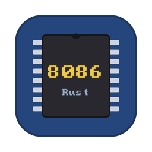

<p align="center">
  
</p>

<h1 align="center">RustEmu8086</h1>

<p align="center"><b>English</b> · <a href="README.ru.md">Русский</a></p>

<p align="center"><b>Learn x86 assembly by watching your code execute.</b></p>

<p align="center">
Write 8086 assembly, run programs instruction by instruction, see registers and memory change,<br>
and understand why your program behaves the way it does.
</p>

<p align="center">
  <a href="https://olegdurandin.github.io/RustEmu8086/"><b>▶ Try in browser</b></a>
  &nbsp;·&nbsp;
  <a href="https://github.com/OlegDurandin/RustEmu8086/releases">Download for macOS</a>
  &nbsp;·&nbsp;
  <a href="https://github.com/OlegDurandin/RustEmu8086/wiki">Documentation</a>
</p>

---

RustEmu8086 is an assembler, emulator and debugger for the Intel 8086, in the spirit of Emu8086. It runs in the
browser on any computer or tablet, and as a native app on macOS. Nothing to install to get started: open the page,
pick an example, press **Step**.

## Try it in one minute

```asm
; Sum of 1 + 2 + 3 + 4 + 5. Press Step (F8) and watch AX, BX and CX change.
org 100h
    mov cx, 5               ; counter
    xor ax, ax              ; sum = 0
    mov bx, 1
next:
    add ax, bx              ; sum += bx
    inc bx
    loop next               ; cx--, repeat while cx != 0
    ret                     ; AX = 15
```

**[Open this program in the emulator →](https://olegdurandin.github.io/RustEmu8086/#name=sum.asm&code=bY7BCsIwEETv_YrxptiWVi2I4qEKnoVeeo3p2hY0KWnUfL5roILVhYEwebM7WxT3G_QFKeZYsJasFSuLcTLU9ygsdZge1zMIVeEprGyQlyH2pTcOJWQjVE1xoE2NNEmaADw3_YB0ITJ8zxZS35Ul4ymnDQRTwo2pnmvtkHx2nZlKA0XObrwnqsonz3-T8x1_eK5Vcnhete7w3vBbyUVRCEMdCYtn016JLUyG-4bGkSGYl1wyzYIX)**
Then press **F8** (or **Step**) a few times. Went too far? **⇧F8** steps back.

## What you can do

- **Step forwards and backwards.** Execute one instruction at a time, or step back up to 2000 instructions —
  registers, memory, the screen and devices all return to where they were.
- **See everything change.** Registers and flags that changed are highlighted; memory, the stack, variables and the
  emulator screen are one click away. Hover over a register or a variable in the editor to see its value.
- **Understand each step.** The tablet layout's *Last step* card says what the last instruction changed
  (`BX 000Fh → 000Eh`, `CF 0 → 1`) and why the flags came out the way they did.
- **Debug at the source level.** Breakpoints with conditions, watches, call stack, Run to cursor, Step over / out,
  stop on condition, stepping into `emu8086.inc` macros.
- **Two assembly languages.** The Emu8086 / MASM dialect and NASM (`nasm -f bin`), detected automatically.
  COM, EXE, BIN and boot-sector programs.
- **A real-feeling PC.** BIOS and DOS services (INT 10h, 16h, 21h, 13h, 33h…), text and VGA 13h graphics, a
  keyboard, a mouse, floppies, a sandboxed drive C:, and the 8087 coprocessor.
- **Emu8086 compatibility.** All 84 examples shipped with Emu8086 assemble and run (except one written for FASM),
  the virtual devices too: traffic lights, stepper motor, robot, thermometer, LED display, printer.
- **A built-in reference** for every instruction, directive and interrupt function, in English and Russian —
  F1 on any word in the editor.
- **Share a program as a link.** The code is packed into the link itself; a teacher sends it, and the student
  opens a ready example.
- **MIPS32 too.** Switch the processor to MIPS32 (toolbar, or the badge on a tablet) for a workspace of its own: the
  MARS assembler syntax, floating point (coprocessor 1), system calls (`syscall`), a Run I/O console, MARS's keyboard and display, bitmap display and Digital Lab Sim in memory, registers grouped by use, flat memory, and the
  same step back, breakpoints and watches. Each processor keeps its own program; switching loses nothing. A MIPS
  reference (instructions with what each pseudo-instruction becomes, `syscall` services, registers) is built in,
  and the `rustemu` command line runs MIPS programs too.

The processor is checked against 2.9 million tests recorded on a real 8088
([SingleStepTests](https://github.com/SingleStepTests/8088)), and instruction encodings against NASM.

## Get it

- **In the browser** — **https://olegdurandin.github.io/RustEmu8086/**. Chrome, Safari, Firefox or Edge, on a
  computer, an iPad or an Android tablet. On a computer you get the Emu8086-style interface, on a tablet — a
  touch layout with a PC keyboard. Programs and files stay in your browser.
- **macOS app** (macOS 11+, Apple Silicon and Intel) — download `RustEmu8086-<version>-macos.zip` from
  [Releases](https://github.com/OlegDurandin/RustEmu8086/releases), unzip and drag `RustEmu8086.app` to
  Applications. The app is not notarized; on first launch right-click it → **Open**, or on macOS 15+ allow it in
  **System Settings → Privacy & Security** (details in
  [Installation](https://github.com/OlegDurandin/RustEmu8086/wiki/Installation#first-launch)).
- **Command line** — `rustemu asm / run / disasm`, included in the app
  (`RustEmu8086.app/Contents/MacOS/rustemu`); see
  [Command line](https://github.com/OlegDurandin/RustEmu8086/wiki/Command-line).

## Documentation

The [wiki](https://github.com/OlegDurandin/RustEmu8086/wiki) is the user guide, in English and Russian:

- [Your first program](https://github.com/OlegDurandin/RustEmu8086/wiki/First-program) — from "Hello, World" to
  step-by-step debugging in 10 minutes;
- [Debugging](https://github.com/OlegDurandin/RustEmu8086/wiki/Debugging) — steps, breakpoints, watches,
  expressions, the DEBUG.EXE console;
- [Emu8086 syntax](https://github.com/OlegDurandin/RustEmu8086/wiki/Emu8086-syntax),
  [NASM syntax](https://github.com/OlegDurandin/RustEmu8086/wiki/NASM-syntax),
  [8087 coprocessor](https://github.com/OlegDurandin/RustEmu8086/wiki/8087-coprocessor),
  [emu8086.inc library](https://github.com/OlegDurandin/RustEmu8086/wiki/Emu8086-inc-library);
- [BIOS and DOS interrupts](https://github.com/OlegDurandin/RustEmu8086/wiki/BIOS-and-DOS-interrupts),
  [Virtual devices](https://github.com/OlegDurandin/RustEmu8086/wiki/Virtual-devices);
- [MIPS32](https://github.com/OlegDurandin/RustEmu8086/wiki/MIPS32) — the second processor: MARS syntax, system
  calls, floating point, macros, memory-mapped devices;
- [Web version](https://github.com/OlegDurandin/RustEmu8086/wiki/Web-version),
  [Tablet layout](https://github.com/OlegDurandin/RustEmu8086/wiki/Tablet-layout),
  [Keyboard shortcuts](https://github.com/OlegDurandin/RustEmu8086/wiki/Keyboard-shortcuts);
- [Differences from Emu8086](https://github.com/OlegDurandin/RustEmu8086/wiki/Differences-from-Emu8086),
  [Troubleshooting](https://github.com/OlegDurandin/RustEmu8086/wiki/Troubleshooting).

## Building from source

Requires macOS 11+ and Rust 1.95+ (`curl https://sh.rustup.rs -sSf | sh`).

```sh
cargo run --release -p rustemu-desktop                       # the app
cargo run --release -p rustemu-desktop -- examples/hello.asm  # open a file right away
./scripts/bundle_macos.sh                                    # RustEmu8086.app + zip (UNIVERSAL=1: arm64 + x86_64)
cargo run --release -p rustemu-cli -- run examples/hello.asm --input x
```

The web version (needs `rustup target add wasm32-unknown-unknown` and [trunk](https://trunk-rs.github.io/trunk/)):

```sh
cd crates/rustemu-web
trunk serve                   # http://127.0.0.1:8080, add ?ui=tablet for the tablet layout
trunk build --release         # the site in crates/rustemu-web/dist/
```

Tests: `cargo test --workspace`. With `nasm` installed (`brew install nasm`) encodings and whole programs are also
compared with NASM byte for byte. The Emu8086 example corpus, the 8088 hardware tests, the crate layout, CI and the
release process are described in [For developers](https://github.com/OlegDurandin/RustEmu8086/wiki/For-developers).

Found a bug or missing a feature? [Open an issue](https://github.com/OlegDurandin/RustEmu8086/issues).

## License

MIT — see [LICENSE](LICENSE).

The MIT license does not cover the Emu8086 materials (Emu8086 was an 8086 emulator published at emu8086.com; the
site and the company no longer exist):

- the **examples** in `examples/` (except `hello_nasm.asm`, `boot_nasm.asm` and the MIPS examples in
  `examples/mips/`) are files from the Emu8086 distribution, unchanged (only the text encoding of `thermometer.asm`
  was converted), and belong to the authors of Emu8086;
- the **`emu8086.inc` library** (`crates/rustemu-asm/inc/`) reproduces the Emu8086 library: its macros and
  procedures, their names, parameters and behaviour belong to the authors of Emu8086; the text of the file was
  written for RustEmu8086.

The tables of MIPS instructions (`crates/rustemu-mips/data/PseudoOps.txt` and `crates/rustemu-mips/src/asm/basic.rs`)
come from [MARS](https://github.com/dpetersanderson/MARS) and are distributed under its MIT license.

More at the end of [LICENSE](LICENSE).
