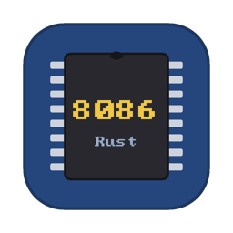

<p align="center">
  
</p>

<h1 align="center">RustEmu8086</h1>

<p align="center"><a href="README.md">English</a> · <b>Русский</b></p>

<p align="center"><b>Изучайте ассемблер x86, наблюдая, как выполняется ваш код.</b></p>

<p align="center">
Пишите программы на ассемблере 8086, выполняйте их по одной инструкции, смотрите, как меняются регистры и память,<br>
и разбирайтесь, почему программа ведёт себя именно так.
</p>

<p align="center">
  <a href="https://olegdurandin.github.io/RustEmu8086/"><b>▶ Открыть в браузере</b></a>
  &nbsp;·&nbsp;
  <a href="https://github.com/OlegDurandin/RustEmu8086/releases">Скачать для macOS</a>
  &nbsp;·&nbsp;
  <a href="https://github.com/OlegDurandin/RustEmu8086/wiki/Главная">Документация</a>
</p>

---

RustEmu8086 — ассемблер, эмулятор и отладчик процессора Intel 8086 в духе Emu8086. Работает в браузере на любом
компьютере и планшете и как приложение для macOS. Чтобы начать, ничего не нужно устанавливать: откройте страницу,
выберите пример, нажмите **Step**.

## Попробуйте за минуту

```asm
; Sum of 1 + 2 + 3 + 4 + 5. Press Step (F8) and watch AX, BX and CX change.
org 100h
    mov cx, 5               ; counter
    xor ax, ax              ; sum = 0
    mov bx, 1
next:
    add ax, bx              ; sum += bx
    inc bx
    loop next               ; cx--, repeat while cx != 0
    ret                     ; AX = 15
```

**[Открыть эту программу в эмуляторе →](https://olegdurandin.github.io/RustEmu8086/#name=sum.asm&code=bY7BCsIwEETv_YrxptiWVi2I4qEKnoVeeo3p2hY0KWnUfL5roILVhYEwebM7WxT3G_QFKeZYsJasFSuLcTLU9ygsdZge1zMIVeEprGyQlyH2pTcOJWQjVE1xoE2NNEmaADw3_YB0ITJ8zxZS35Ul4ymnDQRTwo2pnmvtkHx2nZlKA0XObrwnqsonz3-T8x1_eK5Vcnhete7w3vBbyUVRCEMdCYtn016JLUyG-4bGkSGYl1wyzYIX)**
Затем несколько раз нажмите **F8** (или **Step**). Проскочили нужное место — **⇧F8** делает шаг назад.

## Что можно делать

- **Шагать вперёд и назад.** По одной инструкции или назад до 2000 инструкций — регистры, память, экран и
  устройства возвращаются к прежнему состоянию.
- **Видеть, что меняется.** Изменившиеся регистры и флаги выделены; память, стек, переменные и экран эмулятора —
  в один клик. Наведите мышь на регистр или переменную в редакторе — покажется значение.
- **Понимать каждый шаг.** Карточка *Last step* в интерфейсе планшета показывает, что изменила последняя
  инструкция (`BX 000Fh → 000Eh`, `CF 0 → 1`), и объясняет, почему флаги стали такими.
- **Отлаживать по исходнику.** Точки останова с условиями, watch, стек вызовов, Run to cursor, Step over / out,
  остановка по условию, заход внутрь макросов `emu8086.inc`.
- **Два языка ассемблера.** Диалект Emu8086 / MASM и NASM (`nasm -f bin`), синтаксис определяется сам. Программы
  COM, EXE, BIN и загрузочные секторы.
- **Почти настоящий PC.** Сервисы BIOS и DOS (INT 10h, 16h, 21h, 13h, 33h…), текст и графика VGA 13h,
  клавиатура, мышь, дискеты, диск C: в «песочнице», сопроцессор 8087.
- **Совместимость с Emu8086.** Все 84 примера из поставки Emu8086 собираются и работают (кроме одного, написанного
  для FASM), виртуальные устройства тоже: светофор, шаговый двигатель, робот, термометр, LED-дисплей, принтер.
- **Встроенный справочник** по каждой инструкции, директиве и функции прерываний, на английском и русском —
  F1 на любом слове в редакторе.
- **Программа — ссылкой.** Код упакован прямо в ссылку: преподаватель отправляет её, и у студента открывается
  готовый пример.
- **И MIPS32.** Переключите процессор на MIPS32 (в панели инструментов, на планшете — значок в верхней панели):
  у него своё рабочее место — синтаксис ассемблера MARS, плавающая точка (сопроцессор 1), системные вызовы (`syscall`), консоль Run I/O, клавиатура, дисплей, bitmap display и Digital Lab Sim MARS в памяти, настройки MARS (отложенные переходы, самомодифицирующийся код, компактная память), регистры по
  назначению, плоская память и те же шаг назад, точки останова и watch. У каждого процессора своя программа:
  при переключении ничего не теряется. Встроен справочник по MIPS (инструкции и во что собирается каждая
  псевдоинструкция, сервисы `syscall`, регистры), а командная строка `rustemu` запускает и программы MIPS.

Процессор сверен с 2,9 млн тестов, снятых с реального 8088
([SingleStepTests](https://github.com/SingleStepTests/8088)), кодировки инструкций — с NASM.

## Как получить

- **В браузере** — **https://olegdurandin.github.io/RustEmu8086/**. Chrome, Safari, Firefox или Edge, на
  компьютере, iPad или Android-планшете. На компьютере — интерфейс как в Emu8086, на планшете — интерфейс для
  касаний с PC-клавиатурой. Программы и файлы хранятся в вашем браузере.
- **Приложение для macOS** (macOS 11+, Apple Silicon и Intel) — скачайте `RustEmu8086-<версия>-macos.zip` на
  странице [Releases](https://github.com/OlegDurandin/RustEmu8086/releases), распакуйте и перетащите
  `RustEmu8086.app` в «Программы». Приложение не нотаризовано: при первом запуске — правый клик → **Открыть**, на
  macOS 15+ — разрешение в **Системные настройки → Конфиденциальность и безопасность** (подробно —
  [Установка](https://github.com/OlegDurandin/RustEmu8086/wiki/Установка#первый-запуск)).
- **Командная строка** — `rustemu asm / run / disasm`, есть внутри приложения
  (`RustEmu8086.app/Contents/MacOS/rustemu`); см.
  [Командная строка](https://github.com/OlegDurandin/RustEmu8086/wiki/Командная-строка).

## Документация

[Вики](https://github.com/OlegDurandin/RustEmu8086/wiki/Главная) — руководство пользователя на русском и
английском:

- [Первая программа](https://github.com/OlegDurandin/RustEmu8086/wiki/Первая-программа) — от «Hello, World» до
  пошаговой отладки за 10 минут;
- [Отладка](https://github.com/OlegDurandin/RustEmu8086/wiki/Отладка) — шаги, точки останова, watch, выражения,
  консоль DEBUG.EXE;
- [Синтаксис Emu8086](https://github.com/OlegDurandin/RustEmu8086/wiki/Синтаксис-Emu8086),
  [Синтаксис NASM](https://github.com/OlegDurandin/RustEmu8086/wiki/Синтаксис-NASM),
  [Сопроцессор 8087](https://github.com/OlegDurandin/RustEmu8086/wiki/Сопроцессор-8087),
  [Библиотека emu8086.inc](https://github.com/OlegDurandin/RustEmu8086/wiki/Библиотека-emu8086);
- [Прерывания BIOS и DOS](https://github.com/OlegDurandin/RustEmu8086/wiki/Прерывания-BIOS-и-DOS),
  [Виртуальные устройства](https://github.com/OlegDurandin/RustEmu8086/wiki/Виртуальные-устройства);
- [Процессор MIPS32](https://github.com/OlegDurandin/RustEmu8086/wiki/Процессор-MIPS32) — второй процессор:
  синтаксис MARS, системные вызовы, плавающая точка, макросы, устройства в памяти;
- [Веб-версия](https://github.com/OlegDurandin/RustEmu8086/wiki/Веб-версия),
  [Интерфейс планшета](https://github.com/OlegDurandin/RustEmu8086/wiki/Интерфейс-планшета),
  [Горячие клавиши](https://github.com/OlegDurandin/RustEmu8086/wiki/Горячие-клавиши);
- [Отличия от Emu8086](https://github.com/OlegDurandin/RustEmu8086/wiki/Отличия-от-Emu8086),
  [Вопросы и проблемы](https://github.com/OlegDurandin/RustEmu8086/wiki/Вопросы-и-проблемы).

## Сборка из исходников

Нужны macOS 11+ и Rust 1.95+ (`curl https://sh.rustup.rs -sSf | sh`).

```sh
cargo run --release -p rustemu-desktop                       # the app
cargo run --release -p rustemu-desktop -- examples/hello.asm  # open a file right away
./scripts/bundle_macos.sh                                    # RustEmu8086.app + zip (UNIVERSAL=1: arm64 + x86_64)
cargo run --release -p rustemu-cli -- run examples/hello.asm --input x
```

Веб-версия (нужны `rustup target add wasm32-unknown-unknown` и [trunk](https://trunk-rs.github.io/trunk/)):

```sh
cd crates/rustemu-web
trunk serve                   # http://127.0.0.1:8080, add ?ui=tablet for the tablet layout
trunk build --release         # the site in crates/rustemu-web/dist/
```

Тесты: `cargo test --workspace`. Если установлен `nasm` (`brew install nasm`), кодировки и целые программы ещё и
сверяются с NASM байт в байт. Корпус примеров Emu8086, тесты с реального 8088, устройство крейтов, CI и выпуск
версий — на странице [Для разработчиков](https://github.com/OlegDurandin/RustEmu8086/wiki/Для-разработчиков).

Нашли ошибку или не хватает функции — [создайте issue](https://github.com/OlegDurandin/RustEmu8086/issues).

## Лицензия

MIT — см. файл [LICENSE](LICENSE).

На материалы Emu8086 (эмулятор 8086, выходил на emu8086.com; сайта и фирмы больше нет) лицензия MIT не
распространяется:

- **примеры** в папке `examples/` (кроме `hello_nasm.asm`, `boot_nasm.asm` и примеров MIPS в `examples/mips/`) —
  файлы из поставки Emu8086 без изменений (у `thermometer.asm` только перекодирован текст), принадлежат авторам
  Emu8086;
- **библиотека `emu8086.inc`** (`crates/rustemu-asm/inc/`) повторяет библиотеку Emu8086: её макросы и процедуры,
  их имена, параметры и поведение принадлежат авторам Emu8086; текст файла написан для RustEmu8086.

Таблицы инструкций MIPS (`crates/rustemu-mips/data/PseudoOps.txt` и `crates/rustemu-mips/src/asm/basic.rs`) взяты
из [MARS](https://github.com/dpetersanderson/MARS) и распространяются по его лицензии MIT.

Подробнее — в конце файла [LICENSE](LICENSE).
