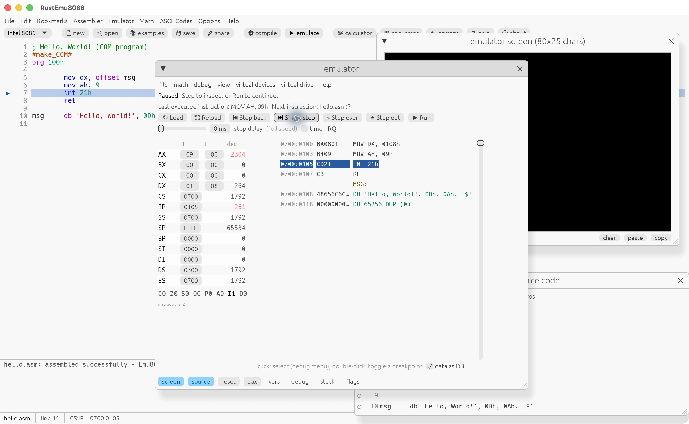
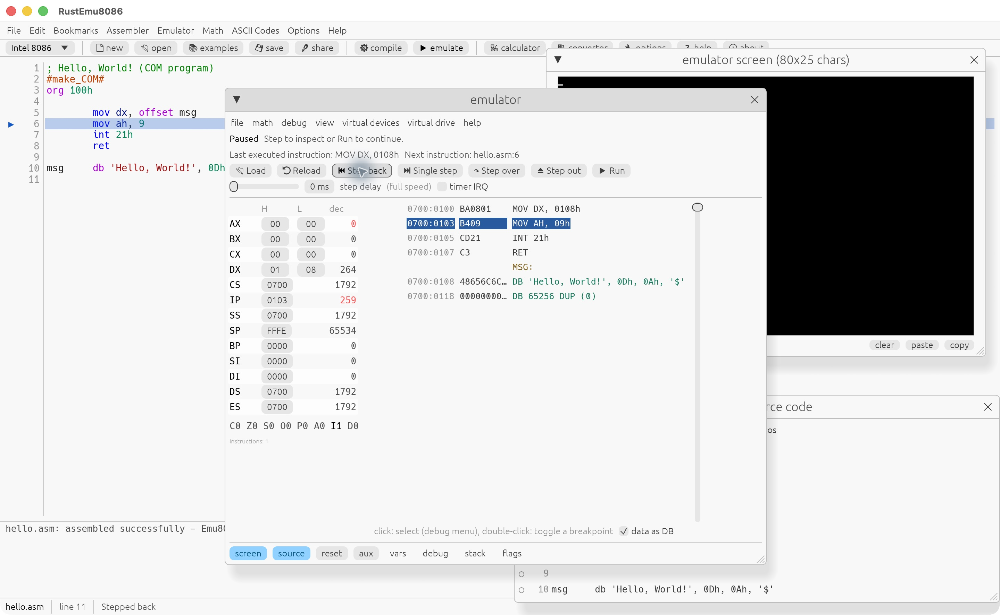
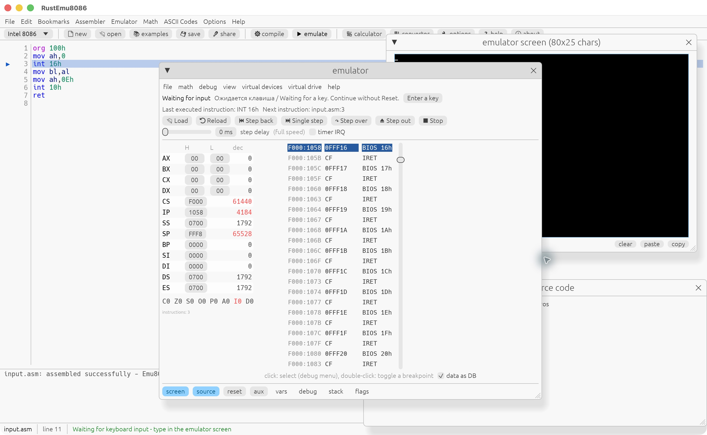
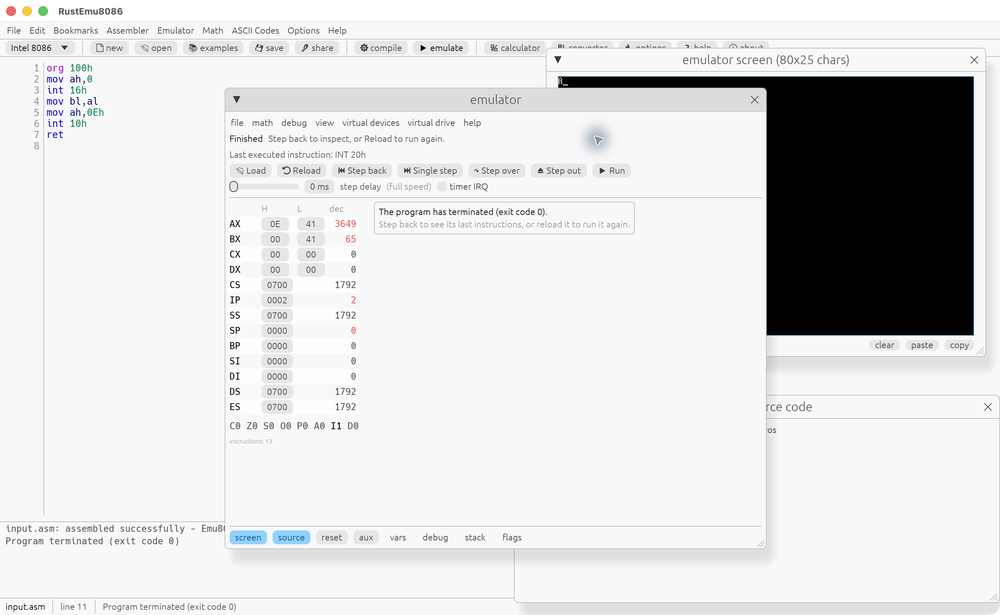
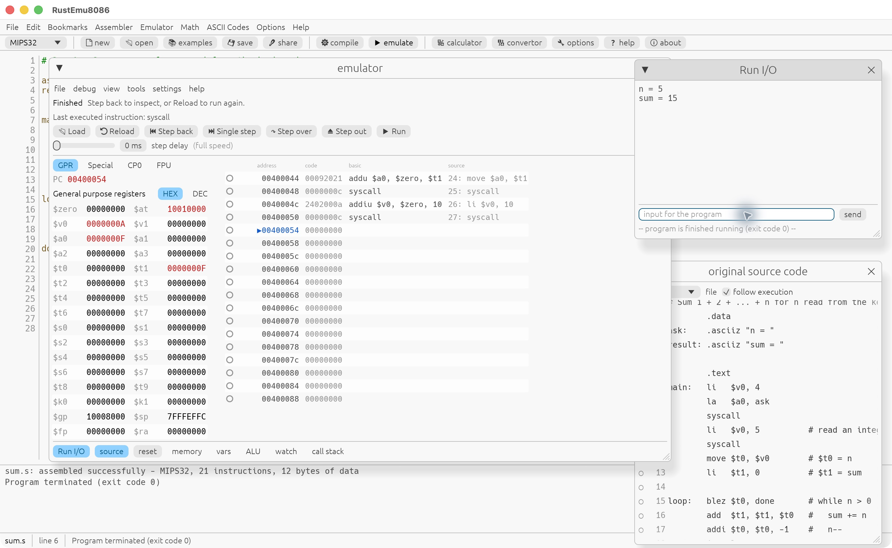
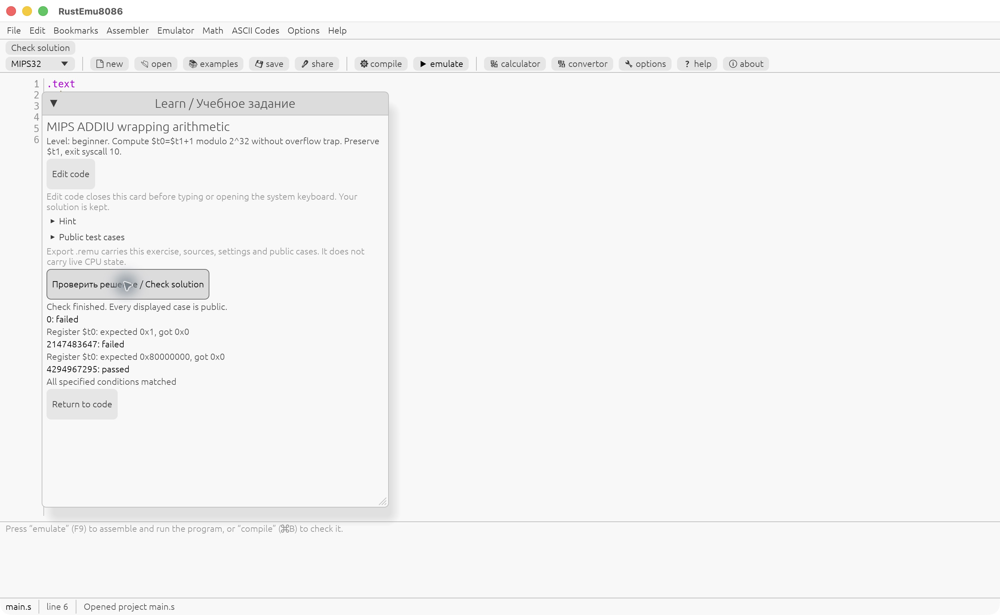
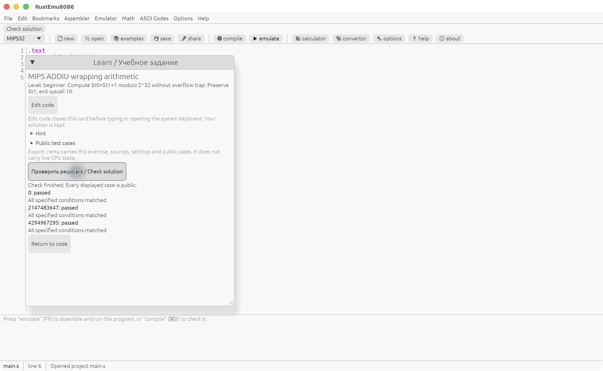
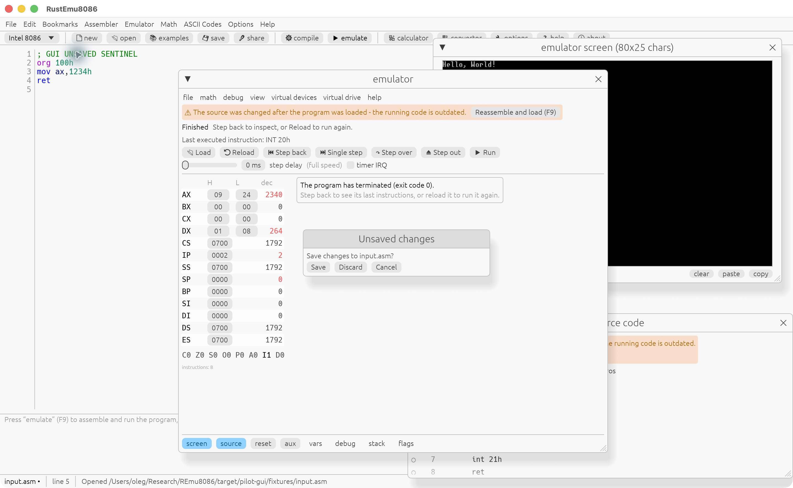
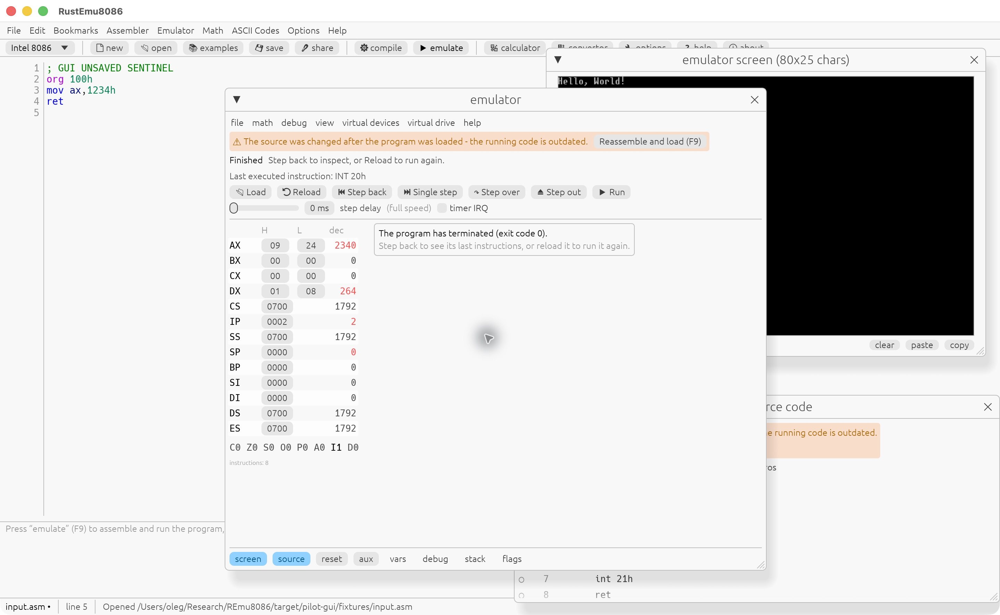

# Реальная проверка desktop GUI — 17 ноября 2026

Проверены **11 выбранных сценариев: 11 PASS, 0 FAIL** в запущенном нативном приложении macOS. Это отдельное дополнение к автоматическим тестам. Браузерные E01–E14, Worker в браузере и физический iPad остаются непроверенными; решение о внешнем пилоте пока не меняется.

## Среда и способ проверки

macOS 26.6.2 (25G83), ARM64, RustEmu8086 0.2.1. Актуальный бинарник собран командой `cargo build --offline -p rustemu-desktop --bin RustEmu8086`. [Лог сборки](desktop-gui/desktop-build.log). SHA256 бинарника: `31d7c0d4055a69a4d6d7e1fbdb7f8e7f6348326f47f22b3da50a08fc65c0ec52`.

Для запуска через Computer Use бинарник помещён в локальную `.app`-оболочку `target/pilot-gui/RustEmu8086-Pilot.app`. Подпись, распространение и штатный установочный пакет этим не проверены. Все действия в интерфейсе выполнены через CUA: системный Open/Save, кнопки, меню, клавиатура и вставка текста. Результаты подтверждались скриншотами. Прямой вызов методов App или подмена состояния GUI не использовались.

Профиль существующий, не чистый. Изначально открытый пользовательский файл не редактировался. Для несохранённых правок использован только собственный `target/pilot-gui/fixtures/input.asm`; тестовая правка после проверки Cancel отброшена через Discard. Файл на диске не перезаписывался. Исходные тестовые файлы и экспорт включены в [fixtures](desktop-gui/fixtures/). [Структурированные результаты](desktop-gui/results.json), [контрольные суммы доказательств](desktop-gui/SHA256.json).

## Выполненные сценарии

| ID | Действия и наблюдаемый результат | Статус |
|---|---|---|
| D01 | Open `hello.asm`, assemble, Run: на экране `Hello, World!`, Finished, exit code 0 | PASS |
| D02 | Single step: AX=0900h, IP=0105h; Step back: AX=0000h, IP=0103h, DX=0108h сохранён | PASS |
| D03 | INT 16h показывает Waiting for input; Enter a key → ввод A: вывод A, BL=41h, Finished/exit 0 без Reset | PASS |
| D04 | MIPS32 `sum.s`: Waiting for input, Run I/O, ввод 5 и Enter → `sum = 15`, exit 0, $t1=0000000F | PASS |
| D05 | Неверное MIPS ADDIU решение: cases 0 и 2147483647 failed с expected/actual; FFFFFFFF проходит допустимо | PASS |
| D06 | Эталонное MIPS ADDIU решение: все три публичных случая passed | PASS |
| D07 | Повреждённый `.remu`: Invalid project / EOF, текущий учебный проект и его код сохранены | PASS |
| D08 | Share → export project → Save `.remu`; повторное Open и Check: три passed, правильный исходник виден | PASS |
| D09 | Проект 8086 с бесконечным INC/JMP: Running → кнопка Stop → Paused; BX и IP доступны для осмотра | PASS |
| D10 | Неопределённый символ: Fault и ошибка строки; повторный Run не меняет BX/IP/счётчик старого образа; затем исправный Hello работает | PASS |
| D11 | Несохранённый sentinel: Open вызывает Save/Discard/Cancel; Cancel закрывает предупреждение и сохраняет текст и dirty marker | PASS |

Сравнение экспортированного JSON с исходным проектом подтвердило равенство `version`, `architecture`, `entry`, `files`, `exercise`, `mars`, `input`, `dialect`. SHA256 экспорта: `9bc617600836c811f89623e58637deeead64d9508d55441e91d67eb73c3d77b0`. Живое состояние CPU в экспорт не входит.

## Иллюстрации и демонстрации

Шаг изменяет регистры и подсветку; Step back возвращает AX/IP к предыдущей инструкции.

Программа 8086 явно сообщает об ожидании клавиши. После ввода продолжает работу и завершается без Reset.

MIPS32 действительно выполняет вычисление после интерактивного ввода: `n = 5`, `sum = 15`.

Проверка учебного решения сравнивает результаты исполнения. Неверное решение получает конкретные расхождения, эталон проходит все случаи.

Защита несохранённых правок работает через явный выбор пользователя.

## Наблюдения и ограничения

- Часть событий при начальном управлении окном не отражалась на экране до действия Raise. Диагностический [стек процесса](desktop-gui/native-hang-sample.txt) показал ожидание событий AppKit, 0% CPU, без подтверждения зависания эмулятора. После Raise команды обрабатывались. Причина задержки доставки/отображения событий не установлена; это не измерение отзывчивости.
- Обычный ASM без метаданных открывается с учётом текущего контекста и сохранённой архитектуры файла. Переключение ISA возвращает отдельный workspace, а не преобразует текущий исходник. В тесте новый ASM сначала попал в MIPS; повторное открытие запомнило этот выбор. Для однозначного учебного обмена рекомендуется `.remu` с явной архитектурой. Проверка Stop выполнена именно с таким проектом.
- Не найден новый подтверждённый производственный дефект, требующий изменения кода. Поэтому в этом дополнении код и регрессионные тесты не изменялись; прежние 499 автоматических PASS относятся к предыдущему завершённому запуску, а 11 GUI PASS учитываются отдельно.
- Не проверены чистый профиль, перезапуск с восстановлением правок, все 12 упражнений в реальном GUI, Cancel check, все устройства/MMIO, браузерный storage/Worker и сетевые сценарии.
- Stop проверен функционально на одном бесконечном цикле. Нет десяти повторов по пяти нагрузкам, видеотрассы, median/p95/max; заявлять ≤100 мс нельзя.
- Доступных браузерных подключений CUA нет. Прежнее ограничение инструмента на управление локальным браузерным URL не обходилось. Реальный браузерный E2E остаётся BLOCKED.
- Физический iPad, Safari touch/IME/Files и экранная клавиатура не тестировались.

Рекомендация: перед внешним пилотом закрыть браузерные E01–E14, чистый профиль, Cancel check, измерения Stop и физический iPad по существующим чеклистам. Текущее решение: **GO CANDIDATE / MANUAL VALIDATION REQUIRED**, внешнее GO не выдано.
